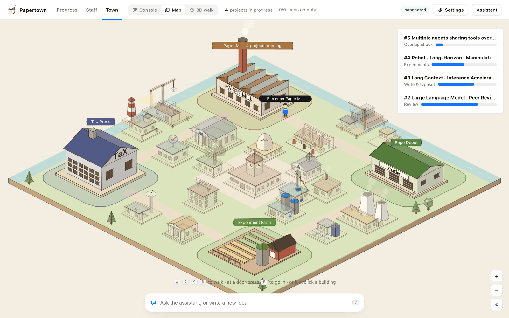
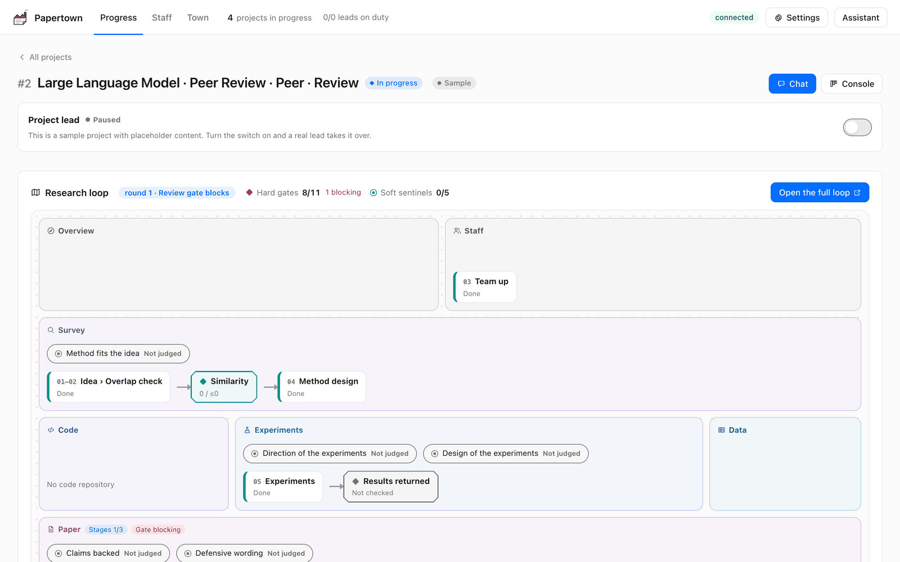

<a id="readme-top"></a>

<div align="center">


# Papertown

**Papertown runs research projects from idea to paper with the coding agents you already use, and draws them as a paper town.**

[![License][license-shield]][license-url]
[![Python][python-shield]][python-url]
[![Node][node-shield]][node-url]
[![Live demo][demo-shield]][demo-url]

English · [简体中文指南](docs/guide.zh-CN.md)

[Report a bug](https://github.com/FanBB2333/papertown/issues/new?labels=bug) · [Request a feature](https://github.com/FanBB2333/papertown/issues/new?labels=enhancement)

</div>

> [!IMPORTANT]
> Papertown does not call any model and holds no model or embedding key. All agent work runs in Claude Code, Codex, or Antigravity under your own login and subscription. While the town runs, each active project's lead stays up and uses your quota, so switch a lead off on its project page when you do not want it working. Workers of a linked project edit your own repositories for real.

## Table of contents

1. [About the project](#about-the-project)
2. [Getting started](#getting-started)
3. [Usage](#usage)
4. [Configuration](#configuration)
5. [Documentation](#documentation)
6. [Development](#development)
7. [Limitations](#limitations)
8. [Contributing](#contributing)
9. [License](#license)
10. [Acknowledgments](#acknowledgments)

## About the project

Papertown manages research projects. An idea goes through eight stages: novelty check, kickoff, method design, experiments, writing, review, and shipping, and comes out as a paper. Agents do the work, and you supervise, correct, and decide at the points that matter. The same projects appear as cards and pages, a research-loop graph, a console, and a paper town (an isometric map and a 3D walk) whose buildings follow live state.

### How a project runs

- **Three layers of agents.** The **assistant** (one for the town) talks with you and acts for you across projects. The **project lead** (one per active project) runs the project: it starts the coder and the writer, assigns their work, hands in stage outputs, opens and closes stages, reports to you, and asks you questions. The **workers** (a coder and a writer per project) write code, run experiments, and write the paper.
- **Resident project lead.** The lead starts when the town starts, when a project is created, and when its switch is turned on. The project page shows its state (`running`, `starting`, `blocked` with the reason, `off`, `ended`) and an on/off switch. Switching it off closes its terminal or interrupts its Paseo turn and keeps the conversation, and switching it on resumes the same conversation. A failed start is retried after a minute, or at once when you turn the switch on again.
- **Hard gates in code.** Hard gates are checked in code, not by the agent: a stage closes only after its required output is handed in and its hard gate passes (for example the novelty similarity, returned experiment results, paper style rules, and PDF freshness). The novelty verdict and similarity scores are computed by code.
- **Runtimes and CLI.** Agents run in [Paseo](https://paseo.sh), a [herdr](https://github.com/herdrdev/herdr) tab, or a [tmux](https://github.com/tmux/tmux) window, and talk to Papertown through the `pt` command in their working directory.

### What you can do

- **Start a project from one idea.** The project is created at once and its lead begins with the novelty check.
- **Follow every project on the Progress page.** One card per project shows its state, decisions waiting for you, running and planned experiments, expected outputs, and repositories, written by the lead when you press Update. Each project page has its decisions, research loop, experiments, and a conversation with its lead.
- **Steer the research loop.** Each project's controls appear as a graph in the same four rows for every project (overview and staff, survey, code / experiments / data, paper). A blocking hard gate locks the next stage and sends a rework ticket until it passes. Soft checks are questions the lead judges, such as whether the claims are supported. Anything the loop cannot resolve goes to you.
- **Watch and step into any agent on the Staff page.** All agents are listed together and sorted by what needs you (waiting for approval or an answer, failed, finished and unread, working, idle). Open an agent to read its conversation, steer the running turn, queue a message, or interrupt it. A terminal agent's prompts (trusting a folder, reviewing hooks, a permission) come up as a dialog you can answer.
- **Ask the staff in the town.** A building's question opens the conversation of that project's coder, writer, or lead, or the assistant when the building has no project.
- **Work in the console.** Open panels for survey, code (an in-browser editor with git diffs), experiments (GPU queue, timelines, results), data, paper (LaTeX source next to the compiled PDF), and agents.
- **Set work bounds.** Define what agents must do, must never do, and must ask you about first, globally, per project, and per agent. Bounds tied to actions (starting a worker, moving a stage, submitting or canceling a job, and more) are enforced by the server.
- **Read pages the agents publish.** HTML reports are shown in a sandbox and can be presented full screen.
- **Bring in your own projects and GPUs.** Link existing code and paper repositories, and read the GPU queue of [nvidb](https://github.com/FanBB2333/nvidb).
- **Keep an eye on your quotas.** The Staff page shows each subscription's 5-hour and weekly windows as a status line: the share used, colored by level, and the time left until each resets. Each project page shows its agents' token usage against the project's budget.
- **Import memory.** Bring in earlier Claude Code and Codex conversations about a project's repositories, with secrets redacted, searchable by its agents.
- **Switch looks and languages.** Choose from three looks (Cloudflare, macOS, paper) and three languages (English, Simplified Chinese, Traditional Chinese).

<p align="center">
  
</p>
<p align="center">
  
</p>
<p align="center"><sub>The town and a project page with the prebuilt sample projects, whose content is placeholder.</sub></p>

### Built with

- [Python](https://www.python.org/) 3.11+ with [FastAPI](https://fastapi.tiangolo.com/) and [SQLite](https://www.sqlite.org/) for the server, the TUI, and the MCP server
- [React](https://react.dev/) 18, [TypeScript](https://www.typescriptlang.org/), and [Vite](https://vite.dev/) for the web app, with [Cloudflare Kumo](https://github.com/cloudflare/kumo) components and [three.js](https://threejs.org/) for the 3D town
- [uv](https://docs.astral.sh/uv/) and [pnpm](https://pnpm.io/)

<p align="right">(<a href="#readme-top">back to top</a>)</p>

## Getting started

You need macOS (Papertown is developed and tested there), Python 3.11+ with [uv](https://docs.astral.sh/uv/), Node 22 with [pnpm](https://pnpm.io/), and at least one agent CLI installed and logged in (Claude Code, Codex, or Antigravity), plus a runtime for it: [Paseo](https://paseo.sh), [herdr](https://github.com/herdrdev/herdr), or [tmux](https://github.com/tmux/tmux). Papertown uses the CLI's own login.

Start the backend:

```bash
git clone https://github.com/FanBB2333/papertown.git
cd papertown/server
uv sync
uv run papertown serve            # http://127.0.0.1:8000
```

Frontend, in another terminal (`/api` is proxied to port 8000):

```bash
cd papertown/web
pnpm install
pnpm dev                          # http://127.0.0.1:5173
```

After `pnpm build`, `papertown serve` serves `web/dist` itself, so the backend alone is enough.

On the first start of an empty town, five prebuilt sample projects show different stages with their outputs, paper sources, and a placeholder lead conversation. They carry a Sample tag and their lead switches start off. Turning on an unfinished sample's lead hands it to a real agent. `PAPERTOWN_SAMPLES=0` turns automatic seeding off, and samples can also be added from Settings.

Pick the default runtime (`paseo`, `herdr`, or `tmux`) in Settings or with `PAPERTOWN_AGENT_RUNTIME`. Papertown never starts or stops the Paseo or herdr daemon. Start it yourself before using that runtime. If the runtime is unavailable, the lead shows as blocked with the reason. To use Paseo, start its daemon with the web UI enabled and install the SDK once:

```bash
paseo daemon start
paseo daemon config set features.webUi.enabled true
paseo daemon restart
cd server/papertown/paseo_link && pnpm install
```

<p align="right">(<a href="#readme-top">back to top</a>)</p>

## Usage

### Start a project from an idea

Write it in the assistant box at the bottom of any page with **New idea** selected (press `/` to open it), or press **Drop in a new idea** at the Paper Mill in the town. The API is `POST /api/ideas`. The project is created with its idea stage done and the novelty check open, and its lead starts. The lead runs `pt survey` and `pt library`, hands in the novelty report with `pt output hatch`, tells you the verdict, and asks you whether to proceed when the idea has been done or needs changes.

### Control the lead

Use the switch at the top of a project page, also shown on its card and in the lead's conversation. Turn it off when the project should rest, and on again to carry on from the same conversation. A blocked lead names the reason there, for example a runtime that is not running. Fix the cause and turn the switch on again to retry at once. `PAPERTOWN_LEAD_RESIDENT=0` turns off automatic lead startup for the whole town, for tests and diagnosis. You can still start a lead by hand from its conversation.

### What the lead and workers can do

| Command | What it does |
| --- | --- |
| `pt status` | where the project stands |
| `pt hire coder\|writer` | start the project's coder or writer (on the default runtime and model unless named) |
| `pt tell coder\|writer "…"` | assign work or send a reminder |
| `pt stage` | the eight stages: whose they are, what is handed in, which gate holds |
| `pt stage run\|done\|todo <stage>` | open a stage or write its progress, close it, or put it back |
| `pt output <stage> '<json>'` | hand in a stage's output (a worker can hand in its own stage's) |
| `pt survey`, `pt library "…"` | the novelty scan by code, and a library search |
| `pt submit main -- python run.py` | submit an experiment to the farm |
| `pt report "…"`, `pt ask "…"` | report to you, or ask you a question |
| `pt checks`, `pt publish page.html` | the project's checks, and publish an HTML page |

Workers have the subset for their own work. In an agent's working directory, `.papertown/pt --help` lists every command.

### Link your own projects

Write `projects.json` in the data directory (it stays out of git):

```json
{"projects": [{"key": "my-proj", "code": "~/repos/my-code", "paper": "~/repos/overleaf/my-paper", "match": ["my-code", "my-proj"]}]}
```

Papertown itself reads these repositories without writing to them. The workers of a linked project work in them directly, so the lead asks you before starting one.

### Use your GPUs

If [nvidb](https://github.com/FanBB2333/nvidb) is installed, Papertown reads its GPU queue to show cards, utilization, and each project's jobs. It never submits or cancels jobs there, and machine addresses and user names stay off the page. Without nvidb, jobs run on the built-in local farm:

```bash
uv run papertown job submit --line line_1 --name main -- python run.py --seed 0
uv run papertown job list
```

### Open it from another device

The server listens on `127.0.0.1` only. Make the port reachable (for example `tailscale serve 8000`) and set an access password under Settings › Access & sign-in.

### Other ways in

- **Terminal UI**: `uv run papertown` in `server/` opens the same projects in the terminal and starts a server if none is running.
- **macOS app**: `macos/build.sh` builds `macos/build/Papertown.app`, and `macos/build.sh --install` copies it to `~/Applications`.
- **MCP server**: other MCP clients can read the library and the project stages:

  ```json
  {"mcpServers": {"papertown": {"command": "uv", "args": ["--directory", "/path/to/papertown/server", "run", "papertown", "mcp"]}}}
  ```

<p align="right">(<a href="#readme-top">back to top</a>)</p>

## Configuration

Papertown reads its settings from the environment, and agent authentication stays with the installed CLI.

| Variable | Purpose |
| --- | --- |
| `PAPERTOWN_AGENT_RUNTIME` | Default runtime: `paseo`, `herdr` or `tmux` |
| `PAPERTOWN_LEAD_RESIDENT` | Resident leads, on by default. `0` turns off automatic startup |
| `PAPERTOWN_ASSISTANT_MODEL`, `PAPERTOWN_LEAD_MODEL` | Default models of the assistant and the leads, as `provider/model@thinking` |
| `PAPERTOWN_WORKER_MODEL` | Default model of coders and writers, following the lead default when empty |
| `PAPERTOWN_DATA_DIR` | Where data is kept (default `server/var`) |
| `PAPERTOWN_PROJECTS` | Your own projects (default `projects.json` in the data directory) |
| `PAPERTOWN_NVIDB` | `0` turns off reading the nvidb GPU queue |
| `PAPERTOWN_SAMPLES` | `0` turns off the sample projects |
| `PAPERTOWN_PRICES` | Model price overrides for the token usage statistics |

The complete list is in [`.env.example`](.env.example) and [`server/papertown/config.py`](server/papertown/config.py).

<p align="right">(<a href="#readme-top">back to top</a>)</p>

## Documentation

The full guide is in Simplified Chinese: [`docs/guide.zh-CN.md`](docs/guide.zh-CN.md). Design notes (in Chinese) in `docs/`:

- [`docs/resident_lead_design.md`](docs/resident_lead_design.md): resident leads and how a project runs
- [`docs/research_loop_design.md`](docs/research_loop_design.md): the research loop, hard gates and soft checks
- [`docs/agent_watch_design.md`](docs/agent_watch_design.md): the Staff page and stepping into a running agent
- [`docs/agent_backends_design.md`](docs/agent_backends_design.md): terminal runtimes, herdr and tmux
- [`docs/usage_budget_design.md`](docs/usage_budget_design.md): subscription usage and project budgets

Skills the agents use live in `server/skills/` and are picked up while the server runs. The library is a SQLite full-text index seeded with 346 arXiv papers, searched with BM25 and keyword coverage.

<p align="right">(<a href="#readme-top">back to top</a>)</p>

## Development

```
assets/   building sprites and their manifest, generated from design/src/sprites.js
design/   design notes and the static prototype
docs/     the full guide (Chinese) and the design notes
macos/    the macOS app shell
server/   FastAPI backend: projects and stages, agents and leads, checks, library, TUI, MCP
web/      React + Vite frontend
```

```bash
cd server && uv run --group dev pytest -q
cd web && pnpm build
cd web && pnpm i18n:missing       # UI strings without an English translation
node design/build.mjs             # regenerate the sprites
```

Interface strings are written in Simplified Chinese in the source and translated through `web/src/i18n/en.json`.

### Static demo

`cd web && pnpm build:demo` builds a read-only demo into `web/dist-demo` from a snapshot of a fresh sample instance with `PAPERTOWN_LEAD_RESIDENT=0`. The steps are at the top of `web/scripts/demo-snapshot.mjs`. The script stops if it finds personal paths, private addresses, or email addresses.

<p align="right">(<a href="#readme-top">back to top</a>)</p>

## Limitations

- Papertown calls no model itself. What a project achieves depends on the agents and models you run, and resident leads use your subscription while the town runs.
- Papertown does not start or stop Paseo or herdr. A lead on an unavailable runtime stays blocked until the runtime is back.
- One user on one machine: the server listens on localhost, and remote access goes through your own tunnel and the access password.
- Developed and tested on macOS only. Linux and Windows are untested.
- The library uses BM25 and keyword coverage, not embeddings, so the novelty check can miss work described in different words. The lead is asked to search with other phrasings as well.
- nvidb is read only. Experiments submitted through Papertown run on the built-in local farm or through the agents' own tools.

Planned work is tracked in the [open issues](https://github.com/FanBB2333/papertown/issues).

<p align="right">(<a href="#readme-top">back to top</a>)</p>

## Contributing

Bug reports, sample projects, skills, translations, documentation fixes, and patches are welcome.

1. Fork the repository and create a branch.
2. Add or update tests for the changed behavior.
3. Run the server tests, `pnpm build`, and `pnpm i18n:missing`.
4. Commit with a [Conventional Commit](https://www.conventionalcommits.org/) message and open a pull request.

For agent or runtime issues, include the runtime, the CLI and its version, and what the lead's state on the project page says.

<p align="right">(<a href="#readme-top">back to top</a>)</p>

## License

Distributed under the MIT License. See [LICENSE](LICENSE) for details.

<p align="right">(<a href="#readme-top">back to top</a>)</p>

## Acknowledgments

- README structure inspired by [Best-README-Template](https://github.com/othneildrew/Best-README-Template)
- Agents run through [Paseo](https://paseo.sh), [herdr](https://github.com/herdrdev/herdr), and [tmux](https://github.com/tmux/tmux), and existing [pi](https://github.com/earendil-works/pi) worker sessions
- Papers from [arXiv](https://arxiv.org/)
- Interface components from [Cloudflare Kumo](https://github.com/cloudflare/kumo), and the 3D town with [three.js](https://threejs.org/)

<p align="right">(<a href="#readme-top">back to top</a>)</p>

[license-shield]: https://img.shields.io/github/license/FanBB2333/papertown?style=for-the-badge
[license-url]: LICENSE
[python-shield]: https://img.shields.io/badge/Python-3.11%2B-3776AB?style=for-the-badge&logo=python&logoColor=white
[python-url]: https://www.python.org/
[node-shield]: https://img.shields.io/badge/Node-22_%2B_pnpm-F69220?style=for-the-badge&logo=pnpm&logoColor=white
[node-url]: https://pnpm.io/
[demo-shield]: https://img.shields.io/badge/demo-papertown.life-0F766E?style=for-the-badge
[demo-url]: https://papertown.life
