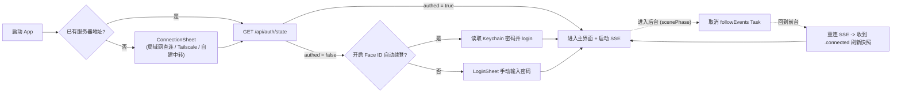

# Papertown iOS · 原生 SwiftUI 前端设计规范

本文档记录 Papertown iOS 端（iOS 16+）采用 **Apple HIG 极简原生控制台（方案 A）** 的界面架构、视觉与组件规范，以及与 [PapertownCore](../ios/README.md) 的协作边界。配套逐页文本与双语文案见 [ios_swiftui_copy_spec.md](ios_swiftui_copy_spec.md)。

---

## 一、设计原则与视觉规范

| 维度 | 规范细节 |
|---|---|
| **图标体系** | **100% SF Symbols（零 Emoji）**，按层级使用 `.hierarchical` / `.monochrome` 渲染模式，遵循 iOS 线宽与语义色。 |
| **色彩系统** | 全面使用系统动态语义色（`systemGroupedBackground`、`secondarySystemGroupedBackground`、`.primary`、`.secondary`、`.tint`、`.green` / `.orange` / `.red`），支持 **System / Light / Dark / Paper** 四种外观切换与动态字体（Dynamic Type）。 |
| **语言策略** | 以 **English (`en`)** 为主语言（`defaultLocalization: "en"`），**简体中文 (`zh-Hans`)** 为可选次语言，支持在 App 内实时切换。 |
| **列表与卡片** | 统一采用标准 `List` + `.listStyle(.insetGrouped)` 与 `Section`（含原生 Header / Footer 说明），保持与 iOS 系统 App 一致的缩进分割线与留白。 |
| **层级与导航** | 根页面使用 `.navigationBarTitleDisplayMode(.large)`，二级页面使用 `.inline`；连接配置、登录验证、新建 Idea 统一采用 `.sheet` + 内部 `NavigationStack` + `Form`。 |

---

## 二、连接与前后台同步流程



- `PapertownClient` 使用 `.ephemeral` `URLSession` 在内存中维护服务端 HttpOnly Cookie。
- 若用户开启 **Auto Sign-In with Face ID / Touch ID**，仅在 iOS Keychain 中安全存储访问密码，重启 App 时自动续登，无需改动服务端鉴权协议。

---

## 三、SF Symbols 图标映射清单（零 Emoji）

| 语义 | SF Symbol | 使用位置 |
|---|---|---|
| Inbox Tab | `tray.fill` | Tab 1（带原生 `.badge(count)`） |
| Projects Tab | `folder.fill` | Tab 2 |
| Staff Tab | `person.2.fill` | Tab 3 |
| Town Tab | `building.columns.fill` | Tab 4 |
| Server Tab | `server.rack` | Tab 5 |
| Project Lead | `cpu` | 项目详情、员工列表、对话页 |
| Coding Agent | `chevron.left.forwardslash.chevron.right` | 项目详情、员工列表、对话页 |
| Writing Agent | `doc.text` | 项目详情、员工列表、对话页 |
| Field Watcher | `eye` | 员工列表、对话页 |
| Assistant | `sparkles` | 员工列表置顶、对话页 |
| 硬卡口 / 受阻警告 | `exclamationmark.triangle.fill` | 待办告警、项目状态、错误提示 |
| 终端权限请求 | `terminal.fill` / `terminal` | 待办审批、对话页权限条 |
| 实时通道健康 / 重连 | `dot.radiowaves.left.and.right` / `arrow.triangle.2.circlepath` | 导航栏状态胶囊、对话页、服务器页 |
| 局域网 / HTTPS / HTTP | `wifi` / `lock.shield` / `globe` | 已保存服务器列表 |
| 工具调用折叠 | `wrench.and.screwdriver` | 对话页 `DisclosureGroup` |
| 发送 / 停止 / 新建 | `arrow.up.circle.fill` / `stop.circle` / `plus` | 对话输入栏、工具栏 |

---

## 四、核心界面与 SwiftUI 组件结构

### 1. Inbox（`InboxView` · Tab 1）
- **容器**：`NavigationStack(path:)` + `List(.insetGrouped)` + `.refreshable`。
- **连接横幅**：SSE 重连或断网时在列表顶部呈现原生提示 `Section` 与 `Retry` 按钮。
- **Needs Your Attention**：聚合三类高优待办——终端权限审批（`Allow` / `Deny` / `View Chat`）、负责人提问（`Reply` / `Open Project`）、受阻负责人（`Retry` / `Open Project`）；全部清空时展示原生 `ContentUnavailableView`（iOS 16 自动回退等效视图）。
- **Active Projects**：展示进行中项目的线性 `ProgressView` 与当前阶段摘要，点击推入 `ProjectDetailView`。

### 2. Projects & Project Detail（`ProjectsView` / `ProjectDetailView` · Tab 2）
- **列表页**：原生 `.searchable` 搜索栏 + `Picker(.segmented)`（`All` / `Needs You` / `Active` / `Done`）+ 8 阶段胶囊进度条 + 工具栏 `+` 呼出 `NewIdeaSheet`（`POST /api/ideas`）。
- **详情页**：
  - `Project Lead` 区块：原生 `Toggle` 控制常驻负责人开关，副文按 `running / starting / blocked / off / off(sample) / ended` 6 种状态动态展示。
  - `Research Progress` 区块：完整项目标题、可展开 Idea 文本、8 阶段进度条与阻断告警行。
  - `Team` 区块：各角色成员列表（含未读圆点与状态标签），点击直接推入 `AgentChatView`。

### 3. Staff & Agent Chat（`StaffView` / `AgentChatView` · Tab 3）
- **员工列表**：原生 `.searchable` + 工具栏排序菜单（`Sort by Urgency` / `Group by Project`）；置顶全局 `Assistant`，其余按 `Needs You → Failed → Unread → Working → Idle → Off` 分组。
- **对话页**：
  - `ScrollViewReader` + `LazyVStack` 按 `AgentEvent.id` 升序去重合并，支持文本选择与 Markdown 渲染。
  - 工具调用事件采用原生 `DisclosureGroup` 默认折叠展示。
  - `.safeAreaInset(edge: .bottom)` 承载底部输入区：包含排队消息操作条（`Send Now` / `Withdraw`）、待批权限冲突警示、仅在 Agent 工作中显示的 `Picker(.segmented)`（`Steer` / `Queue` / `Interrupt`）及多行自适应 `TextField`。
  - 发送途中若连接中断，弹出确认 `Alert` 引导先执行 `Refresh History` 防止重复发送。

### 4. Server & Connection Sheets（`ServerView` / `ConnectionSheets` · Tab 4）
- **当前连接**：标准 `LabeledContent` 展示 `Live Feed`、`Route`、`Session`、`Address`。
- **已保存的服务器**：复刻 iOS 设置列表交互（点选切换、右侧蓝色 `checkmark`、左滑 `Edit Address` / `Delete`）。
- **外观与语言**：原生 `Picker` 实时切换 `Appearance` 与 `Language`。
- **连接与登录 Sheet**：标准 `NavigationStack` + `Form`（`TextField`、`SecureField`、Face ID `Toggle`），退出会话使用 `.confirmationDialog` 二次确认。

### 5. Town（`TownView` · Tab 4）
- **小助手**：置顶入口，进入后与 `AgentChatView(target: .agent("assistant"))` 共用对话页；待批准的操作（`act`）以卡片列出 `Allow` / `Deny`。
- **当前**：进行中的项目数（有项目时用主题色）与在岗负责人 `running/on`（全部在运行为绿、正在启动为橙、无法运行为红、无人开启为灰），与网页顶栏的重点色规则一致。
- **小镇**：部门、图书馆检索（`/api/rag/search`）、算力（执行器、任务、GPU）、模型额度、接线局与技能。

### 6. 项目子页面（`ProjectPages.swift`）
- 进展卡、汇报与提问（`AnswerSheet` 选项或自填）、卡口与检查（按工序分组，可进入单项看发现的问题和历史）、研究回路、撞车报告、方法设计、实验（结果表、任务与运行）、论文（摘要、评审、编译、PDF）、文件、用量。
- 每页用 `LoadingList` 读取，统一处理加载、错误重试与下拉刷新。

### 7. 对话页的数据来源
- pi agent 读 `GET /api/agents/{id}?after=`，增量合并事件；Paseo 与终端 agent 读 `GET /api/agents/{id}/timeline`，终端 agent 另读 `/screen` 取画面与对话框；herdr / tmux 终端读 `/api/terminals/{id}` 与 `/timeline`。
- 小助手发消息走 `POST /api/assistant/say`，其余走 `/say`（终端为 `/api/terminals/{id}/say`）。

### 8. 离线演示与服务端文本
- `DemoServer` 是挂在 `PapertownClient` 下的 `URLProtocol`，用 `Resources/Demo` 中导出的样例答复回答只读请求，图书馆检索在本地书架上计分，写操作返回 403。
- 服务端返回的中文文本在英文界面下经 `ServerText` 翻译，词典与匹配步骤与网页 `web/src/i18n.ts` 相同。

---

## 五、工程目录结构

```text
ios/
├── Package.swift                  # PapertownCore + PapertownUI + 测试目标
├── Sources/
│   ├── PapertownCore/             # Foundation 网络、鉴权与 SSE 基础层
│   └── PapertownUI/               # 原生 SwiftUI 界面、TownStore、双语本地化资源
├── Tests/
│   ├── PapertownCoreTests/        # 网络、鉴权与 SSE 解析单测
│   └── PapertownUITests/          # 双语文案、状态格式化、零 Emoji、事件合并单测
└── PapertownApp/                  # @main iOS App 入口、Info.plist 与 Papertown.xcodeproj
```
