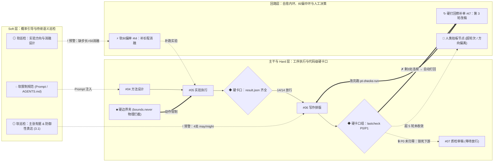
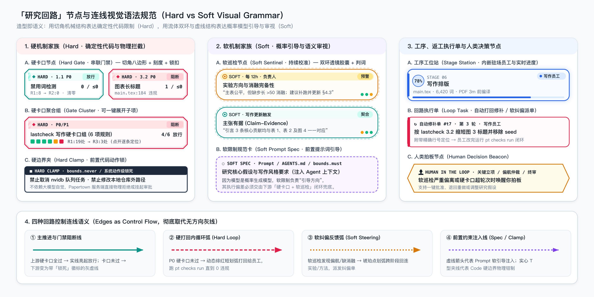
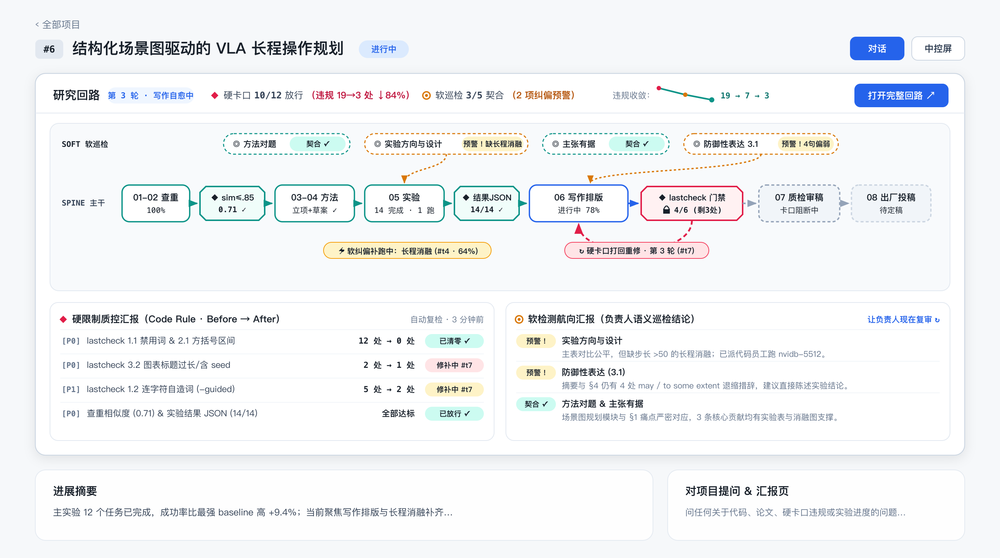
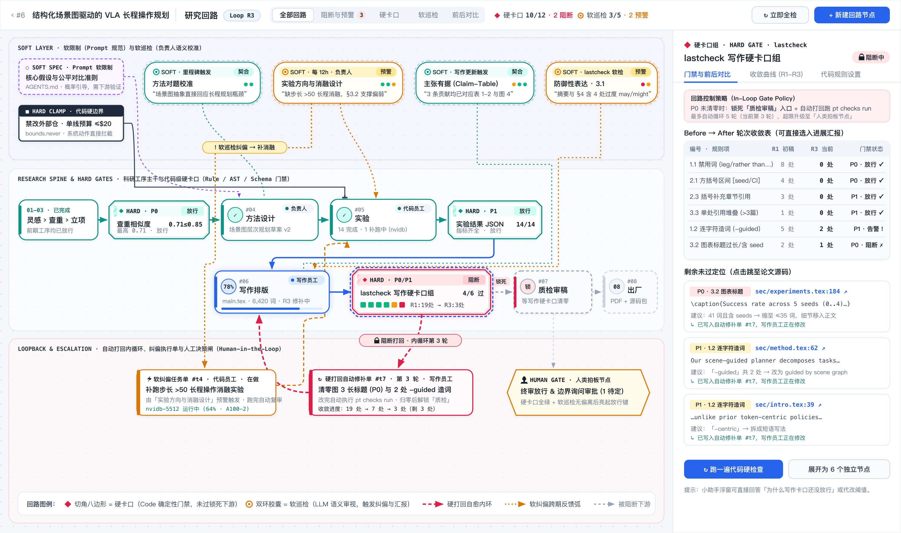

# Papertown「研究回路」（Research Loop）设计方案

## 1. 为什么第一版「研究画布」不满足预期？

对照当前已实现的 [`Canvas.tsx`](../web/src/progress/Canvas.tsx)、[`CanvasCard.tsx`](../web/src/progress/CanvasCard.tsx)、[`canvas.py`](../server/papertown/canvas.py) 与 [`checks.py`](../server/papertown/checks.py)，第一版画布更像一面**静态状态看板 / 思维导图**，尚未真正表达全流程 Agent 科研闭环（Research Loop）的核心控制逻辑。核心症结有四点：

1. **检查节点只是“旁挂树叶”，没有“门禁阻断”与“打回闭环”语义**
   在 [`canvas.py`](../server/papertown/canvas.py) 的 `_first_layout` 中，检查节点以无方向灰线散挂在工序外侧（`stage:write — check:words`）。读者看不出：**某项硬检查没过时，是否锁死了下一道工序？有没有触发内循环让员工自动重修？**
2. **缺少“前置限制（Constraint）”与“后置检测（Verification）”的成对表达**
   全流程 Agent 化科研中，大模型是概率生成模型：通过 Prompt / `AGENTS.md` / `bounds.must` 施加的是**软限制（概率引导，无法保证 100% 遵守）**。通过代码动作拦截（`bounds.never`）与规则检测器（如 `lastcheck` 的正则/LaTeX 语法计数、`result.json` 校验）施加的才是**硬限制（确定性底线）**。第一版画布没有把「软引导 vs 硬钳制」以及它们与下游「软巡检 vs 硬卡口」的因果关系画出来。
3. **节点造型同质化，且被 8 张大体积资料卡喧宾夺主**
   当前硬检查（`176×36` 小方签）与软检查（`176×36` 小胶囊）尺寸微弱、造型近似，而画布中央塞满了 8 张重复项目页信息的 `info:*` 资料卡（`250×130`），导致视觉重心变成了“汇报卡片拼贴”，淹没了 Loop 本身。
4. **缺少面向进展汇报的「Before → After 收敛证据」与「软检测定性结论」出口**
   正如 `lastcheck`（`-1. Report format`）所要求的：硬检测不仅要计数，还要以 **Before → After** 对比汇报每轮迭代收敛情况。软检测（实验方向、消融完备性、防御性表达等）的判断则应直接沉淀为进展汇报中的航向评估。

---

## 2. 命名方案：从「研究画布」升级为「研究回路」

「画布（Canvas）」暗示一块随意摆放便签的白板。而我们要表达的是**带确定性铁闸（Hard Gate）、概率航向仪（Soft Sentinel）与多级打回自愈弧的科研闭环系统**。

| 候选名称 | 英文标识 | 语感与侧重点 | 推荐度 |
| --- | --- | --- | --- |
| **研究回路** | **Research Loop** | **首选推荐。**「回路」兼具 **Feedback Loop（迭代闭环）** 与 **Control Circuit（含断路器/传感器的控制电路）** 双重含义。四字平实克制，与 Papertown 现有的「进展」「中控屏」「工作边界」语感完全统一。 | **★ 首选** |
| **质控回路** | **Guardrail Loop** | 突出软硬护栏与质量门禁（Quality Gate），适合强调 `lastcheck` 等规则保障。 | 备选 A |
| **科研轨图** | **Loop Track** | 呼应小镇流水线“轨道 + 信号灯 + 扳道岔（放行/打回）”的工程意象，贴合「节点+进度图」。 | 备选 B |
| **闭环图谱** | **Loop Graph** | 偏拓扑图谱风格，强调工序、约束、检测与任务之间的结构关系。 | 备选 C |

> [!TIP]
> URL 路由可平滑兼容现有 `/progress/<编号>/canvas`（或新增别名 `/progress/<编号>/loop`），保留已有书签与小助手指令。

---

## 3. 核心概念模型：Hard 与 Soft 的四象限闭环逻辑

在「研究回路」中，我们将科研约束与检测明确划分为 **Hard（确定性代码层）** 与 **Soft（概率模型语义层）** 两条正交链路，并组合成**三层嵌套循环**：

| 机制维度 | **Hard 机制（代码与规则 · 确定性底线）** | **Soft 机制（Prompt 与语义 · 概率航向）** |
| --- | --- | --- |
| **为什么存在** | 大模型输出具有随机性，格式、计数、禁用词、指标 Schema 等**绝对不能靠 Prompt 祈祷模型自觉**，必须由确定性代码把关。 | 科学问题是否对题、实验设计是否公平充分、论证是否过度退缩（如 `lastcheck 3.1`），无法写成正则，必须靠高阶模型的语义审视。 |
| **前置输入（限制）** | **硬边界夹（Hard Clamp）**：绑定系统动作的 `bounds.never` / 目录沙盒，代码级物理拒绝违规调用。 | **软限制卡（Soft Prompt Spec）**：`AGENTS.md`、核心假设、`bounds.must`、写作规范，作为上下文引导生成分布。 |
| **后置把关（检测）** | **硬卡口（Hard Gate）**：**串联在工序出口**（如 `lastcheck` 1.1/1.2/2.1-2.4/3.2/3.3、查重 `≤0.85`、`result.json` 齐全、PDF 最新）。精确输出违规数 `value / ≤ max` 与 `file:line`。 | **软巡检（Soft Sentinel）**：**并联挂载在迭代环上方**（如方法对题、实验方向、实验设计、主张有据、防御性表达）。按里程碑或周期唤醒项目负责人评判 `契合 / 预警 / 偏离`。 |
| **未通过时的回路动作** | **锁死下游 + 自动打回自愈内环（Micro Loop）**：P0 未归零时直接锁住下游工序，生成精确到行号的修补单打回员工，员工循环改稿并跑 `pt checks run` 直至归零放行。 | **语义纠偏 + 升级拍板中/外环（Meso / Macro Loop）**：`预警` 时向实验/写作工序派发补消融或改写任务单。`严重偏离` 时升级到「人类拍板节点」请你定夺。 |
| **进展汇报产出** | **Before → After 轮次收敛表**（如 `R1: 19 处违规 → R3: 3 处 ↓84%`），直观证明质量底线被代码闭环收紧。 | **航向评估摘要**（直接展示负责人的定性判断、风险点与正在执行的纠偏动作）。 |

---

## 4. 视觉语法规范：6 类异构节点与 4 类控制连线

为了彻底告别“所有节点都是差不多的小方框”，我们采用 **“造型即控制物理属性（Form Follows Mechanics）”** 的设计准则：

### 4.1 节点造型体系
1. **硬卡口节点（`Hard Gate`）—— 45° 切角八边形 + 双层机械实框 + 工业斜纹铭牌**
   - **视觉特征**：锋利的 45° 切角（Chamfered Octagon）、等宽数字刻度（`0 / ≤0`、`4/6 放行`）、右上角门禁状态章（`放行` / `阻断` / `告警`），底部显示轮次收敛轨迹（`R1:19处 → R3:3处`）。
   - **聚合与展开（Gate Cluster）**：同一工序下的多项规则（如写作阶段的 6 项 `lastcheck` 硬规则）默认聚合为一个**「硬卡口组」节点**，底部以方格矩阵（`■ ■ ■ ■ ▨ ☒`）展示各项子状态。点击可原地展开为 6 个独立切角节点，兼顾全局清爽与单点细查。
2. **硬边界夹（`Hard Clamp`）—— 深色铆钉顶栏 + 粗实框**
   - **视觉特征**：深灰黑实心标题条 `■ HARD CLAMP`，表达不依赖模型自觉、由服务端代码直接拦截的刚性边界（如 `bounds.never` 动作锁、只读仓库保护、工序推进权限）。
3. **软巡检节点（`Soft Sentinel`）—— 双环流体胶囊 + 外圈呼吸虚线环 + 一句话判词**
   - **视觉特征**：大圆角胶囊配半透明虚线外环，顶部标注巡检周期与评判主体（`SOFT · 每 12h · 负责人`），中部显示巡检命题与历史判断色点串（`● ● ▲`），底部直接摘录最新一句定性判词。
4. **软限制规范卡（`Soft Prompt Spec`）—— 紫罗兰细虚线信笺框**
   - **视觉特征**：虚线边框直观传达“这是注入给概率模型的软性引导（Prompt / `AGENTS.md`），其遵循程度需由下游卡口和巡检验证”。
5. **工序工位站（`Stage Station`）—— 宽体圆角工位舱（内嵌实时指标，取代散落的 `info:*` 资料卡）**
   - **视觉特征**：左侧带环形完成度/锁死徽标，右上角内嵌**驻场员工状态胶囊**（如 `● 写作员工`），底部直接展示核心产物摘要（如 `main.tex · 6,420 词`、`14 完成 · 1 补跑中`），核心资料集中呈现在工序节点内。
6. **回路执行单（`Loop Task`）与人类拍板节点（`Human Gate`）**
   - **回路执行单**：左侧粗色条工单造型，明确标注触发源（`↻ 硬打回自动修补单 #R3` vs `⚡ 软纠偏任务单`）与收敛进度。
   - **人类拍板节点**：琥珀色六边形信标，专用于立项审批、`bounds.ask` 授权确认及软硬异常升级仲裁。

### 4.2 四类有向控制连线（取代无语义直线）
- **主推进与门禁锁死线**：硬卡口全过时为翠绿/品牌蓝实线箭头。硬卡口阻断时，下游连线变为**灰虚线 +「锁死」红章**，工序站同步进入虚线待放行态。
- **硬打回内循环弧（绯红短划流动线）**：从 `硬卡口 [阻断]` 经修补工单弯回上游工序，线上悬挂胶囊路牌 `🔒 阻断打回 · 内循环第 3 轮`。当违规归零放行后，自动收拢为细灰历史轨迹弧（保留 `✓ 3 轮收敛` 记录）。
- **软纠偏跨期反馈弧（琥珀点划柔弧）**：从 `软巡检 [预警/偏离]` 跨阶段连回实验或方法工序，线上悬挂纠偏路牌 `! 软巡检纠偏 → 补消融`。
- **前置约束注入线**：虚线箭头表示软规范注入，实心 T 型端头线表示硬边界物理钳制。

### 4.3 任务之间的顺序线与派发规则（代码维护的硬逻辑）

任务由谁先做、谁后做，属于确定的事实，由服务端代码维护（`canvas.py`），不交给 Agent 判断。回路仍是自由的节点图：先后顺序来自用户自己画的线，代码只负责执行，不内置固定流程。

- **两种线**：两个任务之间的连线默认是**顺序线**（`kind: "order"`，实线箭头，颜色跟随前一个任务的状态），表示先后依赖。可改为**普通连线**，只向 Agent 提供上下文。顺序线不能连成环，会成环的连线自动保留为普通连线。需要反复执行的工作继续使用硬卡口的修补单。修补单的先后由卡口决定，不参与顺序线。
- **任务状态**：在「还没发 / 在做 / 完成 / 卡住了」之外增加「排队中」（`queued`）：已经派发，但还没有轮到。

| 规则 | 行为 |
| --- | --- |
| 开始条件 | 前序任务全部完成（且结果不在待复核状态）后才派发。提前派发的任务进入排队 |
| 自动接力 | 任务回报 done 后，条件已满足的排队任务按排队时间依次派发，派发消息写明前序与后续，并附上前序交回的结果 |
| 阻断 | 任务回报 blocked 时，后续任务继续排队，汇报中列出等待它的任务 |
| 返工 | 已完成的任务被退回、重新打开或再次派发时，其后已运行过的任务标记为「结果待复核」（`stale`），进入人类拍板节点。待复核的任务挡住它的后续，直到用户确认结果仍然有效，或让它重做 |
| 互斥 | 按项目开启（默认关闭）：共用同一工作目录的任务每次只运行一个，其余排队等待目录空闲 |

- **只派发用户排进队列的任务**：自动接力针对排队中的任务，草稿任务保持不动。「连同后续 n 个按顺序派发」一次把整条链排好，链上有任务缺少 Agent 时整体拒绝。
- **派发失败**：轮到的任务若投递失败（例如 Paseo 不可达），保持排队并记录原因，回路上再有变动时自动重试，也可以手动重试。

### 4.4 按研究流程分块（与中控屏同一套组织结构）

回路的背景不再按机制分层，改为按项目的研究流程分块。分块与中控屏左侧「研究流程」的各项一一对应，名称和图标都相同：**概览、调研、代码仓库、实验、数据、论文、员工**。这样整个框架只有一套组织结构：在中控屏里是面板，在回路里是分块。

- **唯一的对应关系**：一道工序属于哪一项，只在服务端定义一次（`pipeline.py` 的 `MODULES` 与 `STAGE_MOD`）。中控屏里点工序打开哪个面板、回路里工序落在哪个分块，读的是同一份数据（工序和回路节点都带 `mod` 字段）。

| 行 | 分块 | 资料卡（项目在这一块现在有什么） | 工序与控制节点 |
| --- | --- | --- | --- |
| 1 | 概览 | 进展、预期产出 | 软限制规范、硬边界夹、人类拍板节点，以及没有绑定工序的检查 |
| 1 | 员工 | 项目负责人、代码员工、写作员工 | 立项编队 |
| 2 | 调研 | 相关工作、方法 | 灵感、查重孵化、方法设计，以及它们的硬卡口和软巡检 |
| 3 | 代码仓库 | 代码 | 没有自己的工序，放派给这一块的任务和备注 |
| 3 | 实验 | 实验任务、实验结果 | 实验工序、交回结果卡口、实验方向与实验设计巡检 |
| 3 | 数据 | 数据集 | 没有自己的工序，放派给这一块的任务和备注 |
| 4 | 论文 | 论文 | 写作排版、质检、出厂投稿，以及它们的硬卡口和软巡检 |

- **四行模板，所有项目通用**：分块从上到下排成四行，对应一篇论文的大致流程。第一行是立项（项目是什么、要产出什么、谁在做），第二行是调研（已有的相关工作和方法），第三行是实验（从左到右：代码、跑出来的结果、数据集），第四行是论文写作。每一行都占满整个宽度，行内多出来的宽度平均分给这一行的分块。
- **高度随内容伸缩**：一个分块的大小由它里面的节点决定，一行的高度取这一行最高的分块。往分块里加任务或把节点往下拖，分块变高，下面的几行整体下移。拿走以后再收回来。把节点拖出分块的左边或上边，分块从那里开始，节点仍留在它的分块里。这一步在服务端每次保存画布时统一计算（`canvas.py` 的 `_fit`），页面按返回的位置更新，所以撤销一次移动是把整张布局放回原样。
- **分块内部**：左边是资料卡，右边是工序和卡口，软巡检在它盯着的工序上方，展开的卡口把各条规则排在它下面，再往下是修补单、任务和备注的网格。员工分块的资料卡在上、立项编队在下，立项编队因此紧挨着调研这一行，它在流程里正处在查重孵化和方法设计之间。资料卡的大小固定（`INFO_SIZE`），内容放不下时截断，在右侧面板里看全文。
- **代码与实验结果的对应**：实验结果卡片列出最近的运行，每次运行写着它的命令跑的是代码仓库里的哪个文件（`python tools/eval.py`、`bash run.sh`、`python -m pkg.mod` 都能认出），代码卡片与实验结果卡片之间默认连着一条「跑出」的线。命令跑的文件不在当前关联的代码仓库里时，卡片照样写出命令里的脚本或模块名，并用虚线框标出。
- **资料卡的归属**：一张资料卡属于哪个分块，只在 `canvas.py` 的 `INFO_MOD` 定义一次。从回路上拿掉的资料卡可以在「更多」里放回它的分块。
- **节点的归属**：工序归它所属的分块，硬卡口、软巡检、修补单和纠偏任务跟着工序。任务和备注由用户决定：放在哪个分块的框里就属于哪个分块，拖进另一个分块就换过去，落在所有框之外时归入最近的分块。一个分块最后一行节点的正下方（直到下一行分块的节点开始处）仍算这个分块，用来给它加一行任务。
- **两个层级**：分块是高一层，节点是低一层。分块的标题栏汇总这一块的状态（工序完成数、卡口是否阻断、巡检预警、任务数），缩小看整个回路时读的是四行分块的标题，点击标题放大到这个分块读内部节点。项目页上的回路卡片是同一套四行分块的紧凑版，点分块的名字进入完整回路的对应分块。
- **仍是自由节点图**：节点可以随意拖动和连线，分块的边框跟着它的节点走。「按分块规整」把每个分块里的资料卡、工序、卡口和巡检放回初始位置，并把任务按顺序线的先后排在它们下方。
- **跨行的主干**：下行的主干从节点底边出来，沿两行之间的空隙横走，在目标工序左侧下行后从左边接入。上行的主干（查重卡口到立项编队）从节点顶边出来，沿空隙横走后从目标的底边接入。上下行各占空隙的一半，互不重叠。
- **旧画布的迁移**：按泳道排布的画布在第一次打开时迁移一次。任务和备注按它们连着的节点归入分块，没有连线的任务按交给谁归入（负责人在概览、代码员工在代码仓库、写作员工在论文），每个分块补上它的资料卡，连线保持原样，原文件另存为 `canvas.before-blocks.json`。

---

## 5. 双层级界面设计样例

### 5.1 项目进展详情页内嵌视图（`/progress/<编号>` 中的「研究回路」节点进度图）

在项目详情页 [`Project.tsx`](../web/src/progress/Project.tsx) 中，用全新的结构化 **`<LoopCard>`（节点+回路进度图 + 软硬质控双栏汇报）** 替换原有的迷你缩略图 `<CanvasCard>`。用户在日常查看项目进展时即可读到：**走到哪一步、被哪道硬卡口拦住、正在跑第几轮自愈循环、以及软硬检测各自得出了什么汇报结论**：

**核心设计亮点：**
- **顶栏双维仪表 + 违规收敛折线**：一眼看到 `硬卡口 10/12 放行（违规 19→3 处 ↓84%）`、`软巡检 3/5 契合` 以及多轮迭代违规下降折线（`19 → 7 → 3`）。
- **中段结构化三轨节点进度图**：固定排布为 `SOFT 软巡检行` + `SPINE 主干与串联硬卡口行` + `底部活跃打回/纠偏回路弧`，字迹清晰可读，点击任意工序、卡口或回路胶囊可直接打开全屏回路并定位到该节点。
- **底部双栏质控汇报区（检测结果即汇报内容）**：
  - 左栏按 `lastcheck` 要求汇总 **硬限制 Before → After 对比与关联修补单**。
  - 右栏汇总项目负责人的 **软检测语义航向结论与纠偏进展**。

---

### 5.2 全屏可交互「研究回路」画布（`/progress/<编号>/canvas`）

点击「打开完整回路 ↗」或任意节点后进入全屏可交互画布：

**交互与面板升级要点：**
1. **按研究流程分块的导引底图（支持自由拖拽 + 一键按分块规整）**：最初的方案是按机制划分的三条泳道（软层、工序主干与硬卡口、回路），现已改为按研究流程分块，见 4.4 节。原来的三条泳道保留为每个分块内部的三行：
   - 上：软巡检胶囊，位于它盯着的工序上方。
   - 中：工序工位站 + **串联在工序之间**的切角八边形硬卡口 / 硬卡口组。
   - 下：软纠偏任务单、硬打回自动修补单、用户的任务与备注。
   - 软规范卡、硬边界夹和人类拍板节点对整个项目起作用，位于「概览」分块。
2. **顶栏视角过滤器**：支持一键切换 `全部回路` | `阻断与预警 (3)` | `硬卡口` | `软巡检` | `前后对比`（切到「前后对比」时弹出整篇论文所有硬卡口与软巡检的完整 Markdown/HTML 汇报大表，支持一键复制或发布到 `/pages` 汇报页）。
3. **右侧检视器（Inspector）深度强化**：
   - **回路控制策略卡片**：可配置某道硬卡口未过时的动作（`锁死下游并自动派修补单` / `仅告警不阻断` / `最大自动循环轮次 N`）。
   - **Before → After 轮次收敛表**：自动对比首轮查出值（`R1`）与当前值（`Rn`），直观展示员工返工成效。
   - **源码级精确定位**：每条违规附带文件名与行号（点击直接跳转中控屏论文/代码编辑器对应行）及关联修补任务号。

---

## 6. 与现有代码的平滑演进映射

本方案完全复用现有后端检测引擎与 React Flow 底座，在已有实现上扩展：

| 模块与文件 | 改造与扩展内容 |
| --- | --- |
| [`checks.py`](../server/papertown/checks.py) | 1. 为 `Hard` 增加门禁行为元数据（默认 `P0` 为 `gate="block"`、`P1` 为 `gate="warn"`，支持项目级覆盖与 `max_rounds=5`）。 2. 在 `view()` 中基于 `checks` 历史表计算每项硬检查的 `before`（首次非空检测值）与 `after`（最新值），直接输出 **Before → After 收敛摘要**。 3. 当 `gate="block"` 的硬检查在对应工序完成后仍未清零时，支持自动创建/更新关联的返工任务单（或供一键触发）。 |
| [`canvas.py`](../server/papertown/canvas.py) | 1. 布局函数 `_layout`：**按研究流程分块的闭环布局**（见 4.4 节），将硬卡口（及可折叠的 `gate_group`，如 `lastcheck` 写作组）**串联进工序之间**，软巡检置于工序上方，回退任务置于工序下方。 2. 为 `edges` 增加语义类型 `kind: "flow" \| "hard_loop" \| "soft_loop" \| "spec" \| "clamp"`。 3. 将原默认铺满画布的 8 张 `info:*` 大卡改为内嵌到 `Stage` 节点的实时摘要字段（仍保留在「更多」菜单中按需拖出某张独立资料卡的能力）。 4. 映射 `bounds.py` 的项目级硬边界/软规范为可选前置节点。 |
| [`CanvasCard.tsx`](../web/src/progress/CanvasCard.tsx) | 升级为 `<LoopCard>`（标题改为「研究回路」）：上半部分渲染响应式三轨 SVG/HTML 节点回路进度图，下半部分渲染「硬限制 Before → After 汇报」+「软检测航向汇报」双栏摘要。 |
| [`Canvas.tsx`](../web/src/progress/Canvas.tsx) & [`canvas.css`](../web/src/progress/canvas.css) | 1. 实现切角八边形 `HardGateNode`（支持聚合态矩阵与展开子项）、双环胶囊 `SoftSentinelNode`、前置约束 `SpecClampNode`、内嵌指标的 `StageStationNode` 及六边形 `HumanGateNode`。 2. 升级 `Wire` 连线组件，支持阻断锁死态、动态流动的绯红硬打回弧、琥珀软纠偏弧及路牌胶囊。 3. 渲染三泳道背景导引层与五档顶栏视角切换（兼容 Cloudflare / macOS / 纸本三种主题及深色模式）。 |
| [`CanvasSide.tsx`](../web/src/progress/CanvasSide.tsx) & [`Checks.tsx`](../web/src/progress/Checks.tsx) | 在检视器中加入「回路控制策略」配置块与「Before → After 轮次收敛表」，并支持一键将当前软硬质控表导出/发布为项目汇报页。 |
